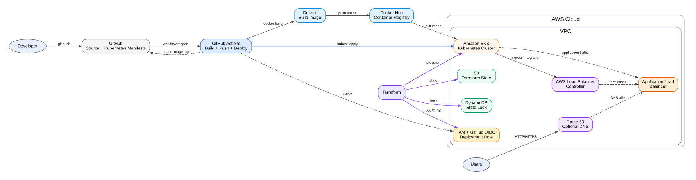
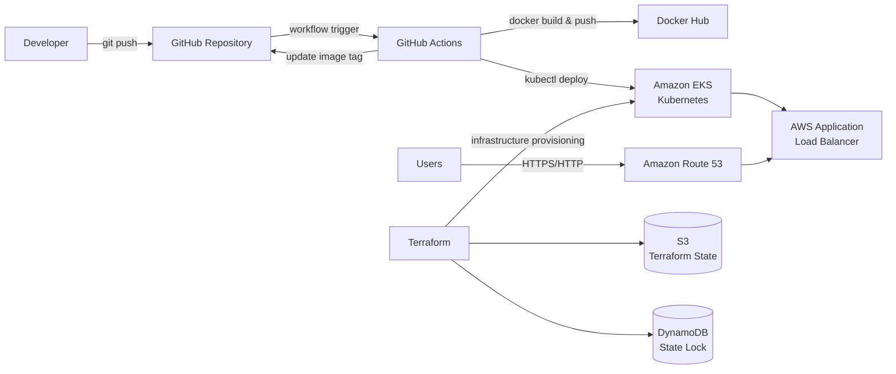

# End-to-End DevOps CI/CD Pipeline on AWS EKS

**Author:** Niranjan J U  
**Project type:** End-to-End DevOps / CI/CD  
**Cloud:** AWS  
**Infrastructure as Code:** Terraform  
**Container:** Docker  
**Registry:** Docker Hub  
**CI/CD:** GitHub Actions  
**Kubernetes:** Amazon EKS  
**Ingress:** AWS Load Balancer Controller + Application Load Balancer  
**DNS:** Amazon Route 53  
**Application runtime:** Python 3.14 + Flask  
**Terraform state:** Amazon S3 + DynamoDB locking  

---

## 1. Project overview

This project demonstrates an end-to-end DevOps CI/CD pipeline that builds, publishes, and deploys a containerized Flask application to Amazon EKS.

### Delivery flow

1. A developer pushes application code to GitHub.
2. GitHub Actions starts the CI/CD workflow.
3. Docker builds the application image.
4. The image is pushed to Docker Hub using the Git commit SHA as an immutable tag.
5. GitHub Actions updates `k8s/deployment.yaml` with the new image tag.
6. GitHub Actions authenticates to AWS using GitHub OIDC and deploys the Kubernetes manifests directly to Amazon EKS with `kubectl`.
7. Kubernetes performs a rolling update.
8. The AWS Load Balancer Controller provisions an Application Load Balancer from the Kubernetes Ingress.
9. Route 53 can provide a custom DNS name for the ALB.
10. Terraform provisions and manages the AWS infrastructure.

GitHub Actions is responsible for both CI and CD.

---

## 2. Architecture

### Project architecture diagram



### Mermaid architecture



### Pipeline flow

```text
Developer
    |
    v
GitHub Repository
    |
    v
GitHub Actions
    |
    +----------------------+
    |                      |
    v                      v
Docker Build          Update Manifest
    |                      |
    v                      v
Docker Hub            GitHub Repository
                           |
                           v
                    AWS OIDC Authentication
                           |
                           v
                      kubectl apply
                           |
                           v
                       Amazon EKS
                           |
                           v
                          ALB
                           |
                           v
                     Route 53 / Users
```

### AWS infrastructure flow

```text
Terraform
   |
   +--> VPC
   |      +--> Public Subnets
   |      +--> Private Subnets
   |      +--> Internet Gateway
   |      +--> NAT Gateway
   |
   +--> Amazon EKS
   |      +--> Control Plane
   |      +--> Managed Node Group
   |      +--> AWS Load Balancer Controller
   |
   +--> GitHub OIDC IAM Role
   |
   +--> S3 Terraform State
   +--> DynamoDB State Lock
```

---

## 3. Repository structure

```text
end-to-end-devops-cicd-pipeline/
├── .github/
│   └── workflows/
│       └── ci-cd.yml                    # Build, push and deploy to EKS
├── app/
│   ├── app.py                           # Flask application
│   ├── requirements.txt
│   └── Dockerfile
├── k8s/
│   ├── namespace.yaml
│   ├── deployment.yaml                  # Kubernetes Deployment
│   ├── service.yaml                     # ClusterIP Service
│   └── ingress.yaml                     # AWS ALB Ingress
├── terraform/
│   ├── bootstrap/                       # S3 + DynamoDB backend
│   └── eks/                             # VPC, EKS, IAM and ALB controller
├── docs/
│   ├── architecture.svg
│   ├── github-actions-aws-oidc.md
│   └── quick-reference.md
├── .gitignore
├── LICENSE
└── README.md
```

---

## 4. Prerequisites

Install/configure:

- AWS account
- AWS CLI
- Terraform >= 1.9
- kubectl
- Helm 3
- Git
- Docker
- GitHub repository
- Docker Hub account
- IAM permissions to create the AWS resources used by this project

Check your AWS identity:

```bash
aws configure
aws sts get-caller-identity
```

Set the region used in the examples:

```bash
export AWS_REGION=ap-south-1
```

On Windows PowerShell:

```powershell
$env:AWS_REGION="ap-south-1"
```

---

## 5. Step 1 - Create the Terraform backend

The backend must exist before the main Terraform stack can use it.

```bash
cd terraform/bootstrap
terraform init
terraform plan
terraform apply
```

This creates:

- S3 bucket for Terraform state
- S3 versioning
- S3 server-side encryption
- DynamoDB table for Terraform state locking

Copy the bucket name from the Terraform output.

---

## 6. Step 2 - Configure the EKS Terraform stack

```bash
cd ../eks
cp terraform.tfvars.example terraform.tfvars
```

Edit `terraform.tfvars`:

```hcl
aws_region         = "ap-south-1"
project_name       = "niranjan-devops"
cluster_name       = "niranjan-eks"
state_bucket_name  = "REPLACE_WITH_BOOTSTRAP_BUCKET"
github_repository  = "YOUR_GITHUB_ORG/YOUR_REPO"
dockerhub_username = "YOUR_DOCKERHUB_USERNAME"
domain_name        = ""
route53_zone_id    = ""
```

`github_repository` must use this format:

```text
organization/repository
```

Initialize the remote backend:

```bash
terraform init \
  -backend-config="bucket=REPLACE_WITH_BOOTSTRAP_BUCKET" \
  -backend-config="dynamodb_table=niranjan-devops-tf-lock"
```

Then deploy:

```bash
terraform plan
terraform apply
```

Terraform provisions:

- VPC
- Public and private subnets across Availability Zones
- Internet Gateway
- NAT Gateway
- Route tables
- Amazon EKS cluster
- EKS managed node group
- EKS OIDC provider
- GitHub Actions OIDC provider
- GitHub Actions IAM role
- EKS access entry for the GitHub Actions role
- AWS Load Balancer Controller
- IAM permissions for the Load Balancer Controller

---

## 7. Step 3 - Connect kubectl to EKS

After Terraform completes:

```bash
aws eks update-kubeconfig \
  --region ap-south-1 \
  --name niranjan-eks
```

Verify:

```bash
kubectl get nodes
kubectl get pods -A
```

You should see the EKS worker nodes in `Ready` state.

---

## 8. Step 4 - Configure Docker Hub

Create a Docker Hub repository, for example:

```text
niranjan-devops-app
```

Create a Docker Hub access token and add these GitHub repository secrets:

| Secret | Value |
|---|---|
| `DOCKERHUB_USERNAME` | Your Docker Hub username |
| `DOCKERHUB_TOKEN` | Docker Hub access token |

The workflow publishes:

```text
YOUR_DOCKERHUB_USERNAME/niranjan-devops-app:<GIT_SHA>
```

and also maintains:

```text
YOUR_DOCKERHUB_USERNAME/niranjan-devops-app:latest
```

The SHA tag is used by Kubernetes so every deployment identifies an exact image version.

---

## 9. Step 5 - Configure GitHub Actions

The workflow is located at:

```text
.github/workflows/ci-cd.yml
```

The workflow uses GitHub OIDC instead of storing long-lived AWS access keys in GitHub.

The Terraform stack creates the IAM role and EKS access entry needed by the workflow.

The workflow performs these actions:

```text
Checkout code
     |
     v
Configure AWS using OIDC
     |
     v
Login to Docker Hub
     |
     v
Build Docker image
     |
     v
Push image to Docker Hub
     |
     v
Update k8s/deployment.yaml
     |
     v
Commit manifest to GitHub
     |
     v
kubectl apply -f k8s/
     |
     v
Wait for rollout
```

### Important GitHub configuration

The Terraform variable must match the repository exactly:

```hcl
github_repository = "YOUR_GITHUB_ORG/YOUR_REPO"
```

The GitHub Actions workflow is restricted to the `main` branch.

---

## 10. Step 6 - Deploy the application manually for the first time

Before the first CI/CD deployment, you can verify the Kubernetes manifests manually.

Edit `k8s/deployment.yaml` and replace:

```text
YOUR_DOCKERHUB_USERNAME/niranjan-devops-app:REPLACE_WITH_GIT_SHA
```

with a real Docker Hub image tag.

Then run:

```bash
kubectl apply -f k8s/namespace.yaml
kubectl apply -f k8s/deployment.yaml
kubectl apply -f k8s/service.yaml
kubectl apply -f k8s/ingress.yaml
```

Check:

```bash
kubectl get all -n devops
kubectl get ingress -n devops
```

For the normal CI/CD path, GitHub Actions performs these deployment steps automatically.

---

## 11. Step 7 - Application Load Balancer

The Kubernetes Ingress uses:

```yaml
ingressClassName: alb
```

and annotations for an internet-facing AWS Application Load Balancer.

Check the controller:

```bash
kubectl get pods -n kube-system | grep aws-load-balancer-controller
```

Check the Ingress:

```bash
kubectl get ingress -n devops
```

After AWS provisions the ALB, the `ADDRESS` field will contain the load balancer hostname.

You can test it with:

```bash
curl http://<ALB-DNS-NAME>/
```

Health endpoint:

```bash
curl http://<ALB-DNS-NAME>/health
```

---

## 12. Step 8 - Optional Route 53 DNS

If you own a Route 53 hosted zone, set the Terraform variables:

```hcl
domain_name     = "example.com"
route53_zone_id = "YOUR_HOSTED_ZONE_ID"
```

The repository's Terraform configuration provides the values needed for DNS integration. You can create an alias record pointing your application hostname to the ALB.

For example:

```text
app.example.com
```

Then users can access:

```text
http://app.example.com
```

For production, use HTTPS with ACM and configure the ALB listener for TLS.

---

## 13. End-to-end CI/CD test

Make a small application change:

```bash
git add .
git commit -m "feat: update application"
git push origin main
```

GitHub Actions will:

1. Start the workflow.
2. Build the Docker image.
3. Push the image to Docker Hub.
4. Replace the Kubernetes image tag with the current Git SHA.
5. Commit the updated deployment manifest.
6. Authenticate to AWS through OIDC.
7. Connect to EKS.
8. Apply the Kubernetes manifests.
9. Wait for the deployment rollout.

Verify the deployment:

```bash
kubectl get deployment -n devops
kubectl get pods -n devops
kubectl rollout status deployment/devops-app -n devops
kubectl get ingress -n devops
```

---

## 14. How rolling deployment works

The Deployment uses:

```yaml
strategy:
  type: RollingUpdate
  rollingUpdate:
    maxUnavailable: 0
    maxSurge: 1
```

This means Kubernetes starts a new pod before removing an old healthy pod, subject to the deployment's readiness checks.

The application exposes:

```text
GET /
GET /health
```

The `/health` endpoint is used by Kubernetes readiness and liveness probes and by the ALB health check.

---

## 15. Useful Kubernetes commands

```bash
kubectl get nodes
kubectl get namespaces
kubectl get all -n devops
kubectl get pods -n devops -o wide
kubectl get svc -n devops
kubectl get ingress -n devops
kubectl describe ingress devops-app-ingress -n devops
kubectl logs deployment/devops-app -n devops
kubectl rollout status deployment/devops-app -n devops
kubectl rollout history deployment/devops-app -n devops
```

Restart the deployment if required:

```bash
kubectl rollout restart deployment/devops-app -n devops
```

Rollback:

```bash
kubectl rollout undo deployment/devops-app -n devops
```

---

## 16. Troubleshooting

### Pods are not starting

```bash
kubectl get pods -n devops
kubectl describe pod <POD_NAME> -n devops
```

Check that the image exists in Docker Hub and that the image name/tag in `deployment.yaml` is correct.

### ImagePullBackOff

Check:

```bash
kubectl describe pod <POD_NAME> -n devops
```

Common causes:

- Incorrect Docker Hub username
- Incorrect repository name
- Incorrect Git SHA tag
- Private Docker Hub repository without an image pull secret

### GitHub Actions cannot authenticate to AWS

Check:

1. `github_repository` in `terraform.tfvars` matches the real repository.
2. The workflow has `permissions: id-token: write`.
3. The workflow runs from the `main` branch.
4. Terraform successfully created the GitHub OIDC provider and IAM role.
5. The IAM role ARN secret/variable in the workflow matches the Terraform output.

### kubectl is forbidden

Verify the GitHub Actions role has an EKS access entry and policy association:

```bash
aws eks list-access-entries --cluster-name niranjan-eks
```

Also verify that the role is the same role used by GitHub OIDC.

### ALB is not created

Check the controller:

```bash
kubectl get pods -n kube-system | grep aws-load-balancer-controller
kubectl logs -n kube-system deployment/aws-load-balancer-controller
```

Then inspect the Ingress:

```bash
kubectl describe ingress devops-app-ingress -n devops
```

### GitHub Actions changes the manifest but deployment does not update

Check the workflow log for the `kubectl apply` and rollout steps. Also verify:

```bash
kubectl get deployment devops-app -n devops -o jsonpath='{.spec.template.spec.containers[0].image}'
```

The output should contain the current Git SHA.

---

## 17. Security recommendations

For a production implementation:

- Use GitHub OIDC instead of long-lived AWS keys.
- Restrict the GitHub Actions IAM role to the required AWS actions/resources.
- Restrict EKS access to the namespaces/resources needed by the deployment pipeline.
- Use private EKS nodes.
- Use HTTPS with ACM certificates.
- Store application secrets in AWS Secrets Manager or Kubernetes Secrets integrated with a secret-management solution.
- Enable S3 versioning and encryption for Terraform state.
- Protect the `main` branch with pull requests and required checks.
- Pin third-party GitHub Actions to trusted versions/SHAs according to your organization's security policy.
- Use Docker image scanning before production deployment.
- Add CPU/memory limits and requests appropriate for the application.
- Enable CloudWatch logging/monitoring for production workloads.

---

## 18. Cleanup

Delete the Kubernetes application resources:

```bash
kubectl delete -f k8s/ingress.yaml
kubectl delete -f k8s/service.yaml
kubectl delete -f k8s/deployment.yaml
kubectl delete -f k8s/namespace.yaml
```

Destroy the EKS infrastructure:

```bash
cd terraform/eks
terraform destroy
```

Then destroy the Terraform backend resources if they are no longer required:

```bash
cd ../bootstrap
terraform destroy
```

> Do not destroy the Terraform backend while another Terraform state still depends on it.

---

## 19. Complete architecture summary

| Component | Purpose |
|---|---|
| GitHub | Source code and Kubernetes manifests |
| GitHub Actions | CI/CD automation |
| GitHub OIDC | Short-lived AWS authentication |
| Docker | Container image build |
| Docker Hub | Container registry |
| Terraform | AWS infrastructure provisioning |
| Amazon VPC | Network isolation |
| Amazon EKS | Kubernetes platform |
| EKS Managed Node Group | Worker compute |
| AWS Load Balancer Controller | Kubernetes-to-ALB integration |
| Application Load Balancer | Public application entry point |
| Route 53 | Optional DNS |
| S3 | Terraform remote state |
| DynamoDB | Terraform state locking |
| Flask / Python 3.14 | Sample application |

---

## 20. Final CI/CD architecture

```text
                         END-TO-END DEVOPS CI/CD

 Developer
     |
     | git push
     v
+----------------+
|     GitHub     |
| Source + K8s   |
|   manifests    |
+-------+--------+
        |
        v
+------------------------+
|    GitHub Actions      |
|------------------------|
| Build Docker image     |
| Push to Docker Hub     |
| Update K8s manifest    |
| AWS OIDC authentication|
| kubectl apply          |
| Rollout verification   |
+----+-------------+-----+
     |             |
     v             v
+----------+   +----------------+
| Docker   |   | Amazon EKS     |
|   Hub    |   | Kubernetes     |
+----------+   +-------+--------+
                       |
                       v
                +--------------+
                | AWS ALB      |
                +------+-------+
                       |
                       v
                +--------------+
                | Route 53      |
                | Optional DNS  |
                +------+--------+
                       |
                       v
                    Users

 Terraform
     |
     +---------------------> AWS VPC / EKS / IAM / ALB Controller
     |
     +---------------------> S3 Terraform State
     |
     +---------------------> DynamoDB State Lock
```

---

## Author

**Niranjan J U**

End-to-End DevOps CI/CD Pipeline using **GitHub Actions + Docker Hub + Terraform + Amazon EKS + AWS ALB + Route 53**, with **direct GitHub Actions deployment to Kubernetes and no Argo CD**.
